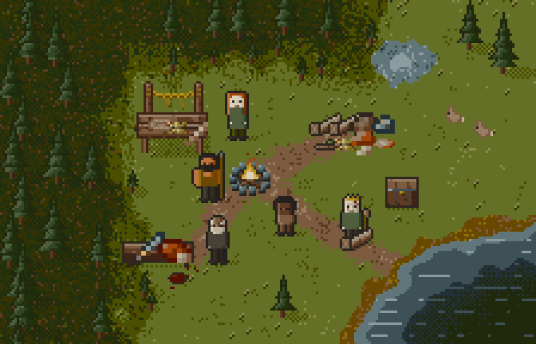
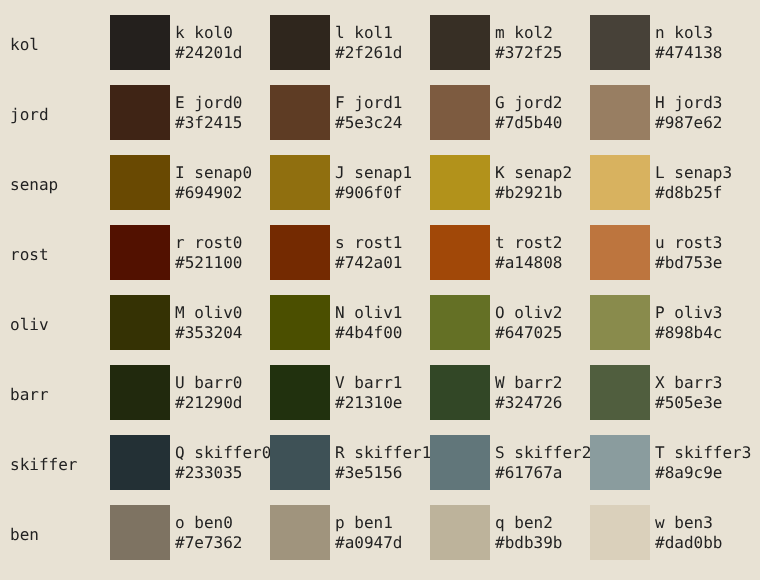
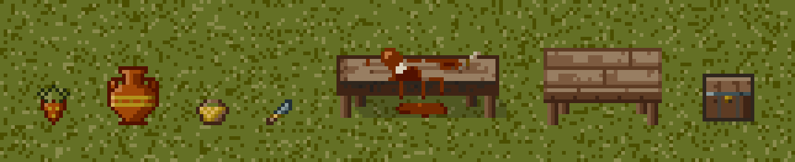
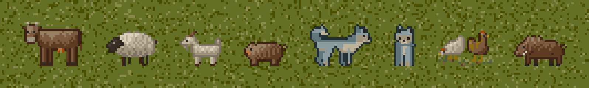

# Så ritas bilderna till Samhällssimulatorn

Ge hela det här dokumentet till den AI som ska rita. Bilderna i dokumentet är facit för stilen.

Skriv sist vad som ska ritas, till exempel: "Rita en jordgubbsplanta som växer på en ruta av åkern, tre versioner."

---

## Uppdraget

Du ritar pixelkonst till ett spel, en by av nordbor under järnåldern.

- Allt syns på en karta som ses snett uppifrån.
- Stilen är smutsig och dämpad, med jordiga mid century-färger (avokadogrönt, senap och rost).
- Bilderna i dokumentet (paletten, byn, djuren och sakerna) är facit för stilen. Det nya ska se ut att höra hemma bland dem.



## Svara så här

Svara med en bild per version som JSON, inget annat:

```json
{ "namn": "Jordgubbsplanta, version 1", "ide": "Låg, bred planta med tre bär som hänger ut över kanten", "w": 16, "h": 16,
  "rader": ["................", "......MNM.......", "..."] }
```

- `rader` har exakt `h` rader, och varje rad är exakt `w` tecken lång.
- En punkt är ett tecken ur palettens tabell nedan. Punkt (`.`) är genomskinligt.
- Inga andra tecken och inga andra färger får förekomma.
- Kan du bara göra bilder i stället för text: gör en PNG där en bildpunkt är en punkt (inte förstorad). Använd bara palettens färger, exakt, och genomskinlig bakgrund.

## Paletten: 32 färger, inga andra

Varje material har fyra toner, från mörkast (0) till ljusast (3). Tecknet står först, sedan färgen.



| Material | 0 (mörkast) | 1 | 2 | 3 (ljusast) | Används till |
|---|---|---|---|---|---|
| kol | `k` #24201d | `l` #2f261d | `m` #372f25 | `n` #474138 | skugga, kol, det som är svart |
| jord | `E` #3f2415 | `F` #5e3c24 | `G` #7d5b40 | `H` #987e62 | jord, läder, trä, brun päls |
| senap | `I` #694902 | `J` #906f0f | `K` #b2921b | `L` #d8b25f | halm, torrt gräs, rep, eld, guld |
| rost | `r` #521100 | `s` #742a01 | `t` #a14808 | `u` #bd753e | blod, kött, lera, bär, röd päls |
| oliv | `M` #353204 | `N` #4b4f00 | `O` #647025 | `P` #898b4c | gräs, löv, mossa |
| barr | `U` #21290d | `V` #21310e | `W` #324726 | `X` #505e3e | granar, mörk skog |
| skiffer | `Q` #233035 | `R` #3e5156 | `S` #61767a | `T` #8a9c9e | sten, vatten, flinta, järn, grå päls |
| ben | `o` #7e7362 | `p` #a0947d | `q` #bdb39b | `w` #dad0bb | ben, snö, ull, vit päls, glans |

Paletten har ingen klarröd, klargrön eller ren vit färg, och inget svart. Det rödaste som finns är `t` och `u`, det ljusaste är `w` och det mörkaste är `k`.

## Storlek: 16 punkter per ruta

Kartan är rutor på 16 × 16 punkter. Allt ritas i sin riktiga storlek mot rutan och förstoras eller förminskas aldrig.

| Sak | Storlek i punkter (bredd × höjd) |
|---|---|
| en människa | 14 × 20 |
| en liten sak (en kniv, ett bär, ett äpple) | ungefär 6–10 åt varje håll |
| en kruka eller en korg | ungefär 8–14 |
| en planta på åkern | högst 16 × 16 (en ruta) |
| en station, ett bord eller en bänk | 16 punkter per ruta den tar, i bredd |
| en ko | 28 × 20 |
| ett får | 23 × 16 |
| en get | 19 × 16 |
| en gris | 20 × 11 |
| en hund, från sidan | 28 × 19 |
| en höna | ungefär 11 × 16 |
| ett vuxet träd | ungefär 31 högt |
| ett gammalt träd | ungefär 46 högt |

När något ritas om behåller det sin storlek, om inget annat sägs.



## Grundreglerna

1. **Snett uppifrån.** Allt ses lite uppifrån, som kartan, aldrig som en platt ritning rakt från sidan eller rakt ovanifrån. Undantaget är väggar, som ses helt uppifrån som ett band.
2. **Ljuset kommer uppifrån vänster.** Den ljusaste tonen sitter uppe till vänster och den mörkaste nere till höger. Rita ingen skugga på marken; spelet lägger dit den.
3. **Kontur i materialets mörkaste ton.** Runt trä används `E`, runt sten `Q` och runt brun päls `E`, aldrig svart. `k` används bara där något verkligen är svart.
4. **Korn, inte fläckar.** Tonen byts punkt för punkt, så att ingen yta är helt slät, men utan mörka fläckar och ensamma prickar. Använd två eller tre toner per material.
5. **Glans** är högst en eller två punkter och aldrig ren vit.
6. **Dämpat, och starkt bara där det betyder något.** De mättade tonerna sparas till det man ska se: elden, blodet, maten och det som går att ta.
7. **Syns mot gräset.** Gräset är oliv i mellantoner (`N`, `O`). En sak behöver kontur och ska vara ljusare eller tydligt annorlunda än gräset, så att den syns.
8. **Läsbart i liten storlek.** En tydlig silhuett och få, stora former går före många små detaljer. Bilden ska gå att känna igen när den är 16 punkter stor.
9. **Symmetriskt det som är symmetriskt.** En kruka, skål, sköld eller tunna är spegelsymmetrisk i formen. Bara ljuset och kornet skiljer sidorna åt.
10. **Logiken först.** Tänk innan du ritar på hur saken står, hålls eller bärs och vad som då syns:
    - på ryggen syns bara det som sticker upp bakom axeln;
    - i handen syns saken från handen och ut;
    - en rem går runt kroppen, aldrig genom huvudet eller ansiktet.
11. **Vet vad bilden är till.** Bestäm först var saken syns, till exempel den växande plantan på åkern eller skörden som en sak i förrådet. Rita bara det.
12. **En sak är en sak.** Det som ligger i förrådet ritas som en enda sak (ett äpple, en limpa), aldrig som en hög.
13. **Stationer snett ovanifrån.** En station, bänk, bord, bädd eller härd ritas så här:
    - arbetsytan (skivan, stocken, hällen) ritas ovanifrån och tar hälften till tre fjärdedelar av höjden;
    - framkanten är ett mörkare band på 2–3 punkter;
    - bara de främre benen syns, som korta stumpar på 3–6 punkter;
    - det som ligger på ytan ritas ovanifrån;
    - inget att sitta på framför.
14. **Det som finns används.** Bygger en ny sak på något som redan finns (en järnyxa på flintyxan, en tam hund på vargen), ritas den från den befintliga bilden, och bara skillnaden ändras. En symbol som betyder samma sak som en som finns (tron, styret) är den symbolen.
15. **Inga nya behållare.** Ligger något i en kruka är det lerkrukan på bilden med sakerna, oförändrad; bara innehållet i öppningen är nytt.
16. **Ett föremål i taget.** Det som är ett eget föremål i spelet (kudden, kannan, verktyget) ritas inte in i en annan saks bild. Sängen har ingen kudde; spelet lägger dit den när den finns.
17. **Järn är grått.** Järn ritas i skiffer (`Q` `R` `S` `T`) med kontur i `Q`, utan rost i kanten om saken inte ska vara rostig.
18. **Terräng i landskapet.** Terräng (marken, myren, ängen, vattnet) ritas aldrig som en ruta med knivskarpa gränser som upprepas. Den växer fram i ett större landskap med mjuka och ojämna övergångar mot det som ligger bredvid.
19. **Tre versioner är tre idéer.** När flera versioner ska göras skrivs först tre idéer i ord, som skiljer sig i form eller byggsätt och inte bara i färg. Varje idé ritas sedan för sig. Idén skrivs i `ide`.

## Djur

Djuren är det svåraste. Titta noga på bilden nedan innan du ritar; de djuren är godkända.



- **Från sidan, lite uppifrån, stående på alla fyra benen.** Huvudet åt vänster eller höger; spelet speglar bilden när djuret vänder.
  - Ingen ställning som springer, sitter, ligger eller anfaller.
  - Spelet flyttar bilden när djuret anfaller.
- **Silhuetten först.** Rita först kroppen som en enkel form i en ton och kontrollera att man ser vilket djur det är:
  - en ko är ett brett rätblock med ett kantigt huvud;
  - ett får är en rund ullboll med ett mörkt huvud;
  - en get är smal med skägg och bakåtböjda horn.
  
  Lägg på tonerna först sedan.
- **Proportionerna.**
  - Benen är 2–3 punkter breda och lika långa.
  - Kroppen är ungefär dubbelt så lång som hög.
  - Huvudet är ungefär en tredjedel av kroppens längd, för ett vuxet djur.
  - Inga stora ögon och inga tecknade drag: ögat är en mörk punkt.
- **Fyra ben.** De två närmaste benen är i pälsens mellanton. De två bortre syns lite förskjutna bakom och är en ton mörkare.
- **Pälsen.**
  - Använd en ramp: jord för brunt, ben för vitt och ljust, skiffer för grått, kol för svart.
  - Två eller tre toner, med kontur i rampens mörkaste ton.
  - Ljusast på ryggen, mörkast på magen och de bortre benen.
- **Varianter.** Ett nytt djur som liknar ett godkänt (en oxe eller häst av kon) ritas med samma kropp, ställning och storlek, och bara det som skiljer ändras: horn, man, svans, färg.
- **Tre versioner av ett djur** är tre olika djur, alla i samma ställning: olika kroppsbyggnad, huvud, horn eller päls. Det ska inte vara samma djur i tre ställningar.

## Plantor på åkern

- En planta ritas som den står på en ruta av åkern, högst 16 × 16 punkter. Rita bara plantan, inte jorden.
- Bladen är oliv (`M` `N` `O` `P`) med kontur i `M` eller `U`.
- Det som ska plockas (bär, frukt, ax) sätts där man ser det, ofta ut över bladkanten. Det ska vara stort nog att synas: ett bär är minst 3 × 3 punkter.
- Bär och annat rött ritas i rost, med `r` som kontur och `t` och `u` som yta och en glanspunkt i `L` eller `w`. Paletten har ingen klarröd färg, så formen och placeringen får göra att bären syns.
- Plantan ska synas tydligt på den mörka åkerjorden (`E`, `F`): ljusare blad (`O`, `P`) överst.

## Kontrollera innan du svarar

- Varje rad har exakt `w` tecken, och det finns exakt `h` rader.
- Bara tecken ur tabellen, och `.` runt saken.
- Ljuset uppe till vänster, kontur runt hela saken.
- Saken syns mot grönt gräs och går att känna igen i liten storlek.
- Storleken stämmer mot tabellen och mot bilderna.
- Det som ska vara symmetriskt är symmetriskt.

## Efteråt

Klistra in JSON-svaret, eller ladda upp PNG-bilden, i programmeringschatten. Där läggs det in som ett kort i bildstilen, med kontrollerna, så att du kan välja som vanligt.
